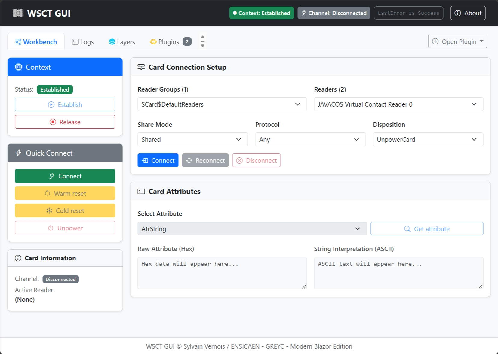
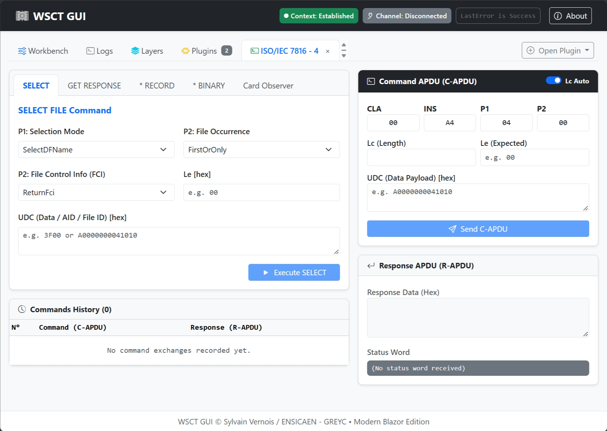

# WSCT-GUI

## What is WSCT-GUI?

The WSCT GUI repository is a modular testing workbench for smart cards using ISO/IEC 7816 standards.

Built on top of the [WSCT.Core](https://github.com/WSCT/WSCT-Core) library.

Developed by S. Vernois @ ENSICAEN / GREYC with the help of some students for proof of concepts.

> [!WARNING]
> **Major UI changes in v7** : it has been migrated from Windows Forms to Blazor (web application).

## Features

- Connect to smart card readers using the PC/SC API
- Send C-APDU commands to smart cards and display R-APDU
- Plugin-based architecture with runtime discovery of plugins
- Plugin Interactive layer allowing capture and replay of CRP

**Supported platforms**:

- Works on Windows, Linux and macOS

## Screenshots

<div align="center">
	
	
</div>

## Prerequisites

### Execution environment

- dotnet 10 Runtime is required.
- dotnet AspNetCore 10 Runtime is required.

## Project structure

### WSCT.GUI.Launcher

Main executable project, containing the main entry point of the application and its configuration.

```bash
# Linux / MacOS / Windows:
dotnet WSCT.GUI.Launcher.dll
# Windows:
WSCT.GUI.Launcher.exe
```

then open a web browser at http://localhost:5000.

- Defines the available card contexts (`Stack.Context.xml`) and channels (`Stack.Channel.xml`)
- Defines the available plugins
	- ISO/IEC 7816-4 APDU
	- Interactive Layer

### WSCT.GUI

Main UI project, containing the GUI application.

### WSCT.GUI.Plugins

- Defines the `interface` to be implemented by all plugins for the GUI application.
- Provides the mechanism for discovery of plugins at runtime.

### Plugin.ISO7816.Tools

- Provides APDU command execution and response display
- Intercepts the APDU commands and responses sent to the lowest layer.

### Layer Interactive and its plugin

- Allows capturing of APDU commands and replaying them.

## Building from source

Prerequisites:

- dotnet SDK 10 is required.

Building the solution from source can be done using the following commands:

```bash
dotnet publish "WSCT.GUI.Launcher/WSCT.GUI.Launcher.csproj" \
    -c Release \
    -o /app/publish \
```
